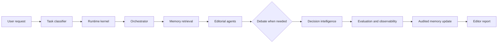

<div align="center">


# NovelOS

**面向百万字长篇小说的 AI 总编辑系统。**

多 Agent 分析、长期记忆、连续性审查与可执行改稿决策；只做诊断、模拟与规划，不批量生成正文。

NovelOS is an AI chief-editor system for million-word fiction: multi-agent analysis, long-term memory, continuity checks, and actionable revision decisions—diagnosis and planning, not bulk prose generation.

[](CHANGELOG.md) [](https://github.com/kdc307950-art/novelos_skill/releases/latest) [](LICENSE)

</div>

## What it does

NovelOS treats a long novel as a living system. It routes each request to the smallest useful set of editorial agents, keeps evidence-backed memory for characters, events, timelines and foreshadowing, and turns competing opinions into traceable decisions.

- Structure, scene, character psychology, relationship and continuity analysis.
- Literary theme, symbolism, narrative voice and aesthetic review.
- Commercial promise, reader retention and audience simulation.
- Multi-agent debate and decision tradeoffs.
- Creative branch simulation with consequence prediction.
- Author preference, feedback and style learning.
- Runtime traces, evaluation datasets, benchmarks and regression cases.

## How it works



## Quick start

Download the latest version from the [v3.10.1 release](https://github.com/kdc307950-art/novelos_skill/releases/latest), or clone the repository:

| Package | Link |
| --- | --- |
| v3.6.0 source archive | [Download ZIP](https://github.com/kdc307950-art/novelos_skill/releases/download/v3.6.0/novelos_skill-3.6.0.zip) |
| Release notes and checksums | [Open v3.6.0](https://github.com/kdc307950-art/novelos_skill/releases/tag/v3.6.0) |

```bash
git clone https://github.com/kdc307950-art/novelos_skill.git
cd novelos_skill
```

Run the dependency free benchmark smoke suite:

```bash
python test.py
```

Expected output:

```text
5 benchmarks
Passed: 5
Failed: 0
```

```text
$novel-analysis 分析第 20 章，检查人物弧光、时间线冲突和章末钩子，给出 P0–P2 改稿计划。
```

```text
$novel-analysis 女主应该死亡还是失忆？请调用文学、人物、商业和读者 Agent，进行 Debate 并比较两个方案的长期后果。
```

## Literary Benchmark Dataset

NovelOS now ships a provenance-first benchmark foundation for literary intelligence. The repository contains six reviewed-track seeds and a generated V3.6 queue of 1,000 synthetic cases awaiting human annotation:

| Track | Purpose | Seed cases |
| --- | --- | ---: |
| `01_Continuity` | Long-range facts, timelines and contradictions | 1 |
| `02_Character` | Motivation, decisions and transformation | 1 |
| `03_Structure` | Setup, turning points and pacing | 1 |
| `04_Literary` | Theme, symbolism and literary mechanism | 1 |
| `05_Commercial` | Promise, hooks and reader risk | 1 |
| `06_Failure` | Overreach, hallucination and weak revision advice | 1 |

Each case keeps provenance, license, source group, split, confidence and verification status. External text is imported only after file level license review; the repository's MIT license does not grant rights to third party datasets.

```bash
python -m crawler.validate_dataset dataset/literary_benchmark
python -m unittest discover -s tests/unit -p "test_dataset*.py"
```

See the [dataset specification](dataset/literary_benchmark/README.md), [golden dataset lifecycle](golden_dataset/README.md), [source catalog](dataset/literary_benchmark/sources/catalog.json), and [ingestion tools](crawler/).

V3.6.5 adds annotation rubrics, a two reviewer process, AI/human score alignment, bias analysis, and A/B comparison directories. Run `python -m dataset_factory.validator.progress golden_dataset/pending` to inspect actual data maturity.

## Repository map

| Directory | Purpose |
| --- | --- |
| `agents/` | Agent contract and editorial roles |
| `orchestrator/` | Routing, modes, execution policy and context levels |
| `runtime/` | Executable pipeline, scheduling, state, logs and Memory Commit |
| `memory/` | Schemas, runtime storage, history and snapshots |
| `memory_engine/` | Retrieval, relevance and context construction |
| `literary_engine/` | Theme, symbolism, prose, voice and aesthetic judgment |
| `literary_graph/` | Reusable literary mechanisms and patterns |
| `creative_engine/` | Branch simulation and consequence prediction |
| `debate_engine/` | Multi-agent argument, conflict resolution and consensus |
| `decision_engine/` | Options, tradeoffs, predictions and final selection |
| `evaluation/` | Quality scoring, prediction and regression evaluation |
| `observability/` | Execution, cost, failure and performance traces |
| `author_model/` | Author taste, beliefs, style and correction memory |
| `dataset/`, `benchmark/`, `tests/` | Golden data, benchmarks and regression cases |
| `crawler/`, `annotation/` | Source discovery, cleaning and human review |
| `evaluation_engine/`, `metrics/`, `optimizer/` | Measured evaluation, agent metrics and failure-driven improvement |
| `experiments/`, `human_eval/`, `evidence/` | Reproducible experiments, blind review and evidence records |
| `agent_analysis/`, `failure_analysis/` | Ablation, contribution and failure intelligence |
| `benchmark_suite/`, `comparison/`, `statistics/`, `ablation/` | Scientific validation, comparison and statistics |
| `interfaces/gui/`, `interfaces/mcp/` | GUI workspace and MCP Alpha adapter |
| `editor_engine/`, `creator_engine/` | Editor Mode and explicitly authorized Creator Mode |
| `memory/canon/`, `memory/writing_state.json` | Canonical facts and draft writing state |

## Runtime modes

Editor Mode is the default. It analyzes, plans, reviews and proposes revisions. Creator Mode is enabled only when the author explicitly asks for drafting, expansion or rewriting:

```text
$novel-analysis Creator Mode：根据这个场景计划生成初稿，先完成 Self Review，再列出需要我确认的 Memory changes。
```

Creator drafts pass through context loading, scene planning, draft generation, self review, revision and author confirmation. Drafts remain separate from canonical Memory until confirmed.

The current MVP runs benchmark fixtures, validates six literary dataset seeds, scores Agent outputs, writes resumable task state, and commits Memory proposals through a validation boundary.

## Design principles

1. Important claims point to a chapter, scene or stored record.
2. Facts, inferences and recommendations remain separate.
3. Agents submit candidate memory changes; Runtime validates before canonical updates.
4. Debate preserves disagreement when evidence or goals do not support one answer.
5. Author feedback changes future priorities only after repeated or explicit confirmation.
6. The system proposes diagnostics, simulations and plans. The author owns the story.

## Documentation

- [NovelOS Literary Benchmark Dataset](dataset/literary_benchmark/README.md) — six categories, source discovery, review and ingestion tools; currently 6 unverified synthetic seeds.

- [Skill entry point](SKILL.md)
- [Contributing](CONTRIBUTING.md)
- [Changelog](CHANGELOG.md)
- [Security and privacy](SECURITY.md)
- [Code of Conduct](CODE_OF_CONDUCT.md)

## License

MIT. See [LICENSE](LICENSE).
