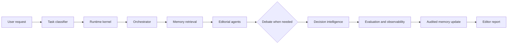

<div align="center">


# NovelOS

**面向百万字长篇小说的 AI 总编辑系统。**

多 Agent 分析、长期记忆、连续性审查与可执行改稿决策；只做诊断、模拟与规划，不批量生成正文。

NovelOS is an AI chief-editor system for million-word fiction: multi-agent analysis, long-term memory, continuity checks, and actionable revision decisions—diagnosis and planning, not bulk prose generation.

[](CHANGELOG.md) [](LICENSE)

</div>

## What it does

NovelOS treats a long novel as a living system. It routes each request to the smallest useful set of editorial agents, keeps evidence-backed memory for characters, events, timelines and foreshadowing, and turns competing opinions into traceable decisions.

- Structure, scene, character psychology, relationship and continuity analysis.
- Literary theme, symbolism, narrative voice and aesthetic review.
- Commercial promise, reader retention and audience simulation.
- Multi-agent debate and decision tradeoffs.
- Creative branch simulation with consequence prediction.
- Author preference, feedback and style learning.
- Runtime traces, evaluation datasets, benchmarks and regression cases.

## How it works



## Quick start

```text
$novel-analysis 分析第 20 章，检查人物弧光、时间线冲突和章末钩子，给出 P0–P2 改稿计划。
```

```text
$novel-analysis 女主应该死亡还是失忆？请调用文学、人物、商业和读者 Agent，进行 Debate 并比较两个方案的长期后果。
```

## Repository map

| Directory | Purpose |
| --- | --- |
| `agents/` | Agent contract and editorial roles |
| `orchestrator/` | Routing, modes, execution policy and context levels |
| `runtime/` | Pipeline, scheduling, state and failure handling |
| `memory/` | Character, timeline, foreshadow, relationship and world schemas |
| `memory_engine/` | Retrieval, relevance and context construction |
| `literary_engine/` | Theme, symbolism, prose, voice and aesthetic judgment |
| `literary_graph/` | Reusable literary mechanisms and patterns |
| `creative_engine/` | Branch simulation and consequence prediction |
| `debate_engine/` | Multi-agent argument, conflict resolution and consensus |
| `decision_engine/` | Options, tradeoffs, predictions and final selection |
| `evaluation/` | Quality scoring, prediction and regression evaluation |
| `observability/` | Execution, cost, failure and performance traces |
| `author_model/` | Author taste, beliefs, style and correction memory |
| `dataset/`, `benchmark/`, `tests/` | Golden data and regression cases |

## Design principles

1. Important claims point to a chapter, scene or stored record.
2. Facts, inferences and recommendations remain separate.
3. Agents submit candidate memory changes; Runtime validates before canonical updates.
4. Debate preserves disagreement when evidence or goals do not support one answer.
5. Author feedback changes future priorities only after repeated or explicit confirmation.
6. The system proposes diagnostics, simulations and plans. The author owns the story.

## Documentation

- [Skill entry point](SKILL.md)
- [Contributing](CONTRIBUTING.md)
- [Changelog](CHANGELOG.md)
- [Security and privacy](SECURITY.md)
- [Code of Conduct](CODE_OF_CONDUCT.md)

## License

MIT. See [LICENSE](LICENSE).
