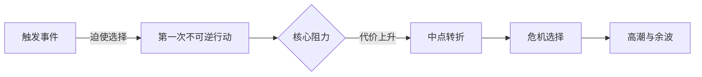
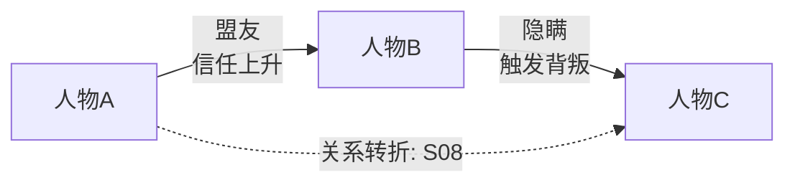
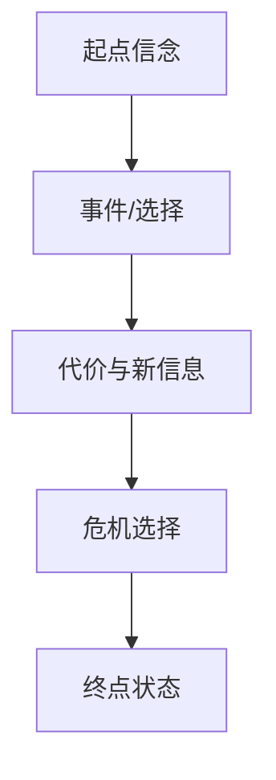

# 小说分析输出 Schema

## 证据与实体

```yaml
scope:
  material: "全文|章节|梗概|设定"
  coverage: "章节或场景范围"
  assumptions: []
  confidence: "高|中|低"
entities:
  - id: C01
    type: "character|place|faction|object|rule|event"
    name: ""
    aliases: []
    first_seen: "S01"
    evidence: ["S01-P03"]
```

场景索引字段：`scene_id, chapter, order, time, place, pov, participants, goal, obstacle, action, outcome, reveal, foreshadow, payoff, evidence`。

## 关系与剧情

人物关系：`source, target, relation, polarity, intensity(1-5), before, after, trigger, evidence`。

剧情事件：`event_id, scene_id, line(main|subplot|romance), actor, goal, conflict, choice, consequence, reversibility, evidence`。

人物弧光：`character, initial_state, wound_or_need, want, lie_or_belief, turning_points[], crisis_choice, final_state, proof_scenes[]`。

冲突记录：`issue_id, category, severity, earliest_location, evidence_a, evidence_b, rule_or_expectation, reader_impact, fix_options[], verification`。

## Mermaid 模板







## 质量检查

- 每个结论至少有一个场景/段落证据，或标为推断。
- 每个 P0/P1 问题都有最小修复方案和验收问题。
- 主线、支线、感情线的事件 ID 不重复且能回指场景。
- 图中关系变化与表格中的 `before/after` 一致。
- 不把作者意图、角色认知、读者已知混为一谈。
- 建议覆盖低成本修补和结构重构的取舍。

## NovelOS 增量变更集

```yaml
change_set:
  - entity_id: C01
    operation: add|update|conflict
    old_value: null
    new_value: ""
    source: "C03-S02-P04"
    confidence: high|medium|low
    canonical: true|false
```

数据库变化必须列出新增、更新和冲突，不能只写自然语言摘要。引擎发现冲突时先写 `conflict`，由作者决策后再标记 canonical。